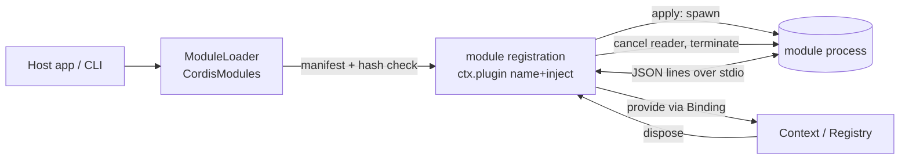

# Proposal 0011 — External module loading with hot and cold activation

> Format: full (triage score ≥ 3/6 — executes third-party code, new public contract, hard to reverse, cross-platform).
> The key words MUST, MUST NOT, SHOULD, SHOULD NOT and MAY are to be interpreted as described in RFC 2119.

## 1. Summary

We propose a `CordisModules` target that loads features from external modules into a running app or CLI, in two modes: **cold** (the enabled set is read at launch) and **hot** (load, unload and reload while running). Modules run as separate processes behind a typed bridge, because a process can be killed and replaced cleanly, which maps exactly onto the existing plugin lifecycle. Unlike `dlopen`, hot unload and replace are safe; the cost is IPC and a trust decision for every module.

## 2. Context

### 2.1 Current state

All plugins are Swift types linked at build time and loaded with `ctx.plugin(P.self, config)` (`Sources/CordisKernel/Context.swift`). A plugin that is disposed, updated or failed is rolled back through its `Scope`, and dependents react (`docs/ARCHITECTURE.md`, Reactivity). Adding a feature means rebuilding and redeploying the host. HANDOFF §10 defers a loader; proposal 0006 (draft) covers a declarative in-process `LoadPlan` but not code that is not linked into the binary.

### 2.2 Problem

An app or CLI cannot gain a feature without a new build. Teams want third parties or other teams to ship add-ons independently, and want to enable or replace them without restarting a long-running process. Doing nothing means every extension is a fork or a rebuild.

### 2.4 Glossary

| Term | Definition |
| --- | --- |
| Module | A directory with a `module.json` manifest and an executable (or, later, a library) that provides a feature. |
| Cold activation | The enabled module set is read once at launch. Changes take effect on the next start. |
| Hot activation | `load`, `unload` and `reload` while the host runs, without restart. |
| Backend | How the host runs a module: `static` (linked in), `process` (child process). |
| Binding | A host-registered, typed mapping from a manifest service id to a `ServiceKey` and its proxy. |

## 3. Goals and non-goals

### 3.1 Goals (verifiable)

- **G1** — A module can be activated cold from a directory at launch, and the result is identical to loading the same plugin in code (test: same final graph and statuses).
- **G2** — `load`, `unload` and `reload` work while the host runs. After `unload`, the module's slots are absent, its fork is `.disposed`, its listener count is back to the pre-load value, and the child PID is gone (test: these four assertions; no dependency on proposal 0004).
- **G3** — A module that crashes, exits, or sends invalid data leaves the rest of the graph running; the module's plugin is `.failed` and `PluginFailed` is emitted.
- **G4** — Services cross the boundary only through bindings registered by the host; an unbound service id is rejected.
- **G5** — A module whose executable hash differs from the hash pinned host-side, or whose `apiVersion` is unsupported, never starts. (Protects against swapped or corrupted binaries, not against an attacker who can already write the host's config.)

### 3.2 Non-goals

- **NG1** — Loading code on iOS, tvOS or watchOS (platform policy; only the `static` backend exists there).
- **NG2** — A sandbox. A child process runs with the user's privileges; this proposal gives crash isolation, not security isolation.
- **NG3** — File watching and auto-reload. Hot actions are explicit calls, which keeps ordering deterministic.
- **NG4** — A module marketplace, signing infrastructure or automatic updates.
- **NG5** — In-process `dlopen` modules (see 5.3).

### 3.3 Requirements

- One additive kernel change: `Context.plugin(name:inject:config:apply:)`, a closure-based entry that builds the `Fork` with a runtime name and `Inject`. `Plugin` stays static-only (`name`, `inject`, `apply` are static, `Plugin.swift:12-17`), so a single generic type cannot carry a per-manifest `inject`; the `Fork` initialiser already takes both (`Context.swift:93-95`). No behaviour of existing APIs changes, and strings never name services inside `CordisKernel` (`AGENT.md`).
- Process I/O runs inside an effect whose teardown cancels the reader and then terminates the child.
- Available on macOS and Linux, compiled out elsewhere with `#if os(macOS) || os(Linux)` (`Foundation.Process` does not exist on iOS, tvOS or watchOS, which `Package.swift` still declares). CI already runs `swift test` on macOS and Linux (`.github/workflows/ci.yml`); `Process` plus stdio pipes on Linux is verified by the spike, not assumed. `Package.swift` cannot list Linux as a platform.

## 4. Proposal

### 4.1 Overview



The loader registers each module with the new `ctx.plugin(name: manifest.id, inject: <from manifest requires>, apply: …)` entry, so every module has its own name (distinguishable in `PluginFailed`) and its own dependencies. The `apply` closure spawns the child, performs the handshake, and for every service the manifest `provides` that has a host binding, calls `ctx.provide` with a proxy. Everything else (pending, restart on dependency change, cascade, rollback) is the existing fork behaviour. **Hot** is therefore the normal lifecycle: `load` creates the plugin, `unload` disposes it, `reload` is dispose then load. **Cold** is the same code driven once at launch from the enabled list.

### 4.2 From the user's point of view

Manifest (`modules/audit/module.json`):

```json
{
  "id": "audit", "version": "1.2.0", "apiVersion": 1,
  "executable": "audit-module",
  "requires": ["logger"], "provides": ["audit-sink"]
}
```

Host:

```swift
var bindings = ModuleBindings()
bindings.register(LoggerKey.self, id: "logger", proxy: LoggerHostService.init)
bindings.register(AuditSinkKey.self, id: "audit-sink", proxy: AuditSinkProxy.init)

let app = Context.root()
let modules = ModuleLoader(context: app, bindings: bindings,
                           searchPaths: [configDir.appending(path: "modules")])

// Cold: at launch, from the enabled list
await modules.loadEnabled()                  // returns [ModuleOutcome]

// Hot: while running (CLI subcommand or app menu)
try await modules.load(id: "audit")
await modules.reload(id: "audit")            // dependents go pending, then active
await modules.unload(id: "audit")
```

CLI: `mytool modules enable <id> | load <id> | unload <id> | reload <id>`. `enable` edits the enabled list (cold, takes effect next launch); `load` acts now (hot).

### 4.3 Detailed design

- **Manifest** is `Decodable`, strict (unknown keys rejected), with `apiVersion` checked against `ModuleLoader.supportedAPIVersions`.
- **Integrity**: the pinned SHA-256 lives host-side in `enabled.json`, written by `enable` (trust on first use), never in the module directory, so swapping the binary and manifest together is detected. The hash is checked on the file immediately before spawn; a TOCTOU window between check and `exec` remains for an attacker with write access to the module directory, so the directory MUST NOT be group or world writable and MUST NOT be resolved from the current directory.
- **Protocol**: newline-delimited JSON-RPC 2.0 over the child's stdin/stdout, stderr forwarded to the logger. Messages: `handshake`, `call(service, method, params)` (host to module), `shutdown`.
- **Bindings** map `id` to `(ServiceKey, proxy factory)`. A proxy implements the service protocol by sending `call` messages. A manifest id with no binding makes `load` fail with `ModuleError.unboundService(id)` before spawn.
- **Reader**: `ctx.effect` runs `setup` and then registers the teardown (`Context.swift:122-125`), so the reader loop must start in `setup`. It is a single `Task` stored by the effect, never detached: teardown cancels it, sends `shutdown`, awaits the task, waits a bounded time, then terminates the child. The `AGENT.md` ban targets fire-and-forget tasks in the kernel; this task is owned and awaited, lives in `CordisModules`, and each message is handled with `await` on `@CordisActor` so order stays deterministic. The spike (7.1) MUST prove this ordering before acceptance.
- **Hot reload** is dispose then apply. Between the two, dependents are pending (existing cascade); no state is carried across, the module owns persistence.
- **Cold set**: a small `enabled.json` list of module ids. Missing or invalid entries are reported as `ModuleOutcome.failed`, never fatal for the host.
- **v1 scope is deliberately small**: cold activation plus `load`, `unload`, `reload`, and `enable` (which writes the pin). Deferred: a `static` backend, module-to-host calls, `event` messages, a malformed-message strike rule, `list`. Tests use a `ModuleTransport` protocol with one in-memory test implementation.

### 4.4 Edge cases and errors

| Case | Behaviour |
| --- | --- |
| Child exits unexpectedly | Reader ends, `apply` task fails the fork: `.failed`, `PluginFailed`, services withdrawn, dependents pending. No auto-restart in v1. |
| Handshake timeout | Child terminated, `ModuleError.handshakeTimeout`. |
| Hash or `apiVersion` mismatch | Not spawned, `.failed` with a typed error. |
| `unload` during a call in flight | Pending calls fail with `ModuleError.unloaded`. |
| Two modules provide the same service | Existing `serviceConflict`; the second fails. |
| Malformed message | That call fails with `ModuleError.protocol`. |
| Host quits | `app.dispose()` runs every module teardown; children are terminated by the host. If the host is killed (SIGKILL) a child survives unless the module exits on stdin EOF; this is the module author's duty, documented in the protocol spec, and the reference test module implements it. A public module SDK is out of scope for v1. |

### 4.5 Goal coverage

| Goal | Where |
| --- | --- |
| G1 | `loadEnabled` drives the same registration path as hot load; test compares snapshots with a code-loaded equivalent |
| G2 | dispose path in 4.3; the four assertions in G2 |
| G3 | 4.4 table |
| G4 | bindings in 4.3 |
| G5 | integrity and `apiVersion` checks in 4.3 |

## 5. Alternatives considered

### 5.1 Do nothing

Extensions stay compile-time: rebuild and redeploy. Zero risk and no new attack surface, but no independent shipping and no hot activation. Acceptable only if no third party ever needs to extend the host.

### 5.2 Standard / off-the-shelf option

SwiftPM packages linked at build time (cold only), or XPC services on Apple platforms (process isolation, signed, but Apple-only and no Linux). We adopt the child-process shape XPC also uses, but over stdio so Linux works.

### 5.3 Alternative B — in-process `dlopen` of a dynamic library

Fast calls and no IPC, but Swift libraries cannot be unloaded safely (runtime metadata stays registered; `dlclose` is unsafe, to verify), so hot unload and replace are not possible, only cold and load-only hot. A crash takes down the host. macOS needs hardened-runtime exceptions or same-team signing. Deferred; it can be a third backend later without changing the registration path.

### 5.4 Alternative C — WebAssembly modules

Real sandboxing and safe in-process hot swap, but requires a Wasm runtime dependency (for example WasmKit, to verify), which needs your approval under the project rules, and host/guest ABI work. Strong candidate for a later phase if security isolation becomes a goal.

### 5.5 Comparison

| | Static only | Process (proposed) | dlopen | Wasm |
| --- | --- | --- | --- | --- |
| Hot unload/replace | no | yes | no | yes |
| Crash isolation | n/a | yes | no | yes |
| Security isolation | n/a | no | no | yes |
| Linux + macOS | yes | yes | yes | yes |
| New dependency | none | none | none | runtime |
| Call overhead | none | IPC | none | low |

### 5.6 Simpler option: host-authored plugin per external executable

The host author writes one ordinary static `Plugin` per external executable that spawns it and speaks JSON over stdio. No manifest, no kernel change, no generics. It is the right choice if there are only a few known modules; it stops scaling when third parties ship modules the host did not anticipate, which is why the manifest-driven loader is proposed.

### 5.7 Abandoned ideas

- File watcher for automatic reload: non-deterministic ordering, deferred (NG3).
- Letting modules name services by arbitrary string: breaks the typed-key rule; replaced by bindings.

## 6. Cross-cutting concerns

- **Security**: a module runs arbitrary code as the user. Mitigations are hash pinning, directory permission checks, no CWD discovery, and an allow-list of bound services; none is a sandbox. A hostile module can still do anything the user can. Document this prominently; sandboxing is the Wasm follow-up.
- **Privacy / compliance**: modules receive only data passed through bindings, but may read the user's files directly. State in docs.
- **Performance / cost**: IPC per service call; keep bindings coarse-grained. Process start cost on load.
- **Compatibility**: new target and public API, additive. The manifest and protocol versions are a public contract and need `apiVersion` discipline.
- **Accessibility / UX**: CLI messages for each `ModuleOutcome`; an app needs its own UI for module state.

## 7. Implementation plan

### 7.1 Steps

| Step | Deliverable | Effort | Depends on |
| --- | --- | --- | --- |
| 1 | Manifest, `ModuleError`, hash and permission checks | 1 d | none |
| 2 | Kernel closure entry `ctx.plugin(name:inject:…)` + tests, transport protocol | 1 d | 1 |
| 3 | Process backend, JSON-RPC, reader effect | 4 d (re-estimate after spike) | 2 |
| 4 | Bindings and a sample proxy service | 1 d | 3 |
| 5 | Loader (cold list + hot actions), CLI sample in demo | 1 d | 4 |
| 6 | Docs and a sample external module | 1 d | 5 |

**Precondition for acceptance: a 1 to 2 day spike** with a throwaway child process echoing a service call. It must show (a) the closure-based `ctx.plugin` entry fits the `Fork` without behaviour change, (b) reader ordering on `@CordisActor` with cancel-then-await teardown, (c) `Process` and stdio pipes on Linux CI. Re-estimate the table after the spike.

### 7.2 Migration

None: additive. Existing plugins are unaffected.

### 7.3 Rollout and rollback

Ship `CordisModules` as a separate experimental library product. Rollback: remove the product; the one kernel addition (`ctx.plugin(name:inject:…)`) is additive and can stay or be reverted without affecting existing callers.

### 7.4 Test strategy

Swift Testing. Unit tests use the static backend and an in-memory transport. Integration tests spawn a small helper executable built by the package: handshake, call, crash, hash mismatch, unload during call, reload with dependents. Each invariant gets its test first (TDD).

### 7.5 Observability

`ModuleOutcome` per load, `PluginFailed` for runtime failures, module stderr forwarded to the logger with the module id. A module listing feeds the snapshot from proposal 0004 if accepted.

## 8. Prior art

- HashiCorp go-plugin and Terraform providers: subprocess plugins over RPC, with handshake and version negotiation (to verify details).
- VS Code extension host and the Language Server Protocol: out-of-process extensions speaking JSON-RPC over stdio.
- Apple XPC services: process isolation with signing and entitlements, Apple-only.
- Cordis / cordis-rs `cordis-loader`: declarative `LoadPlan` over in-process plugins; relates to proposal 0006.

## 9. Open questions

1. Which hosts matter first: a macOS app, a CLI, or both? It affects whether stdio or XPC is the first transport. (decider)
2. Is a trust model of "the user installs only modules they trust" acceptable for v1, or is sandboxing (Wasm) a requirement? (decider)
3. Should modules be able to provide UI (SwiftUI) or only headless services? Proposed: headless only. (decider)
4. Sequencing with draft proposal 0006: does `loadEnabled` reuse its `LoadPlan`, or are the two merged? Decide before either is approved. (decider)

## 10. Review log

| Date | Reviewer | Verdict | Changes made |
| --- | --- | --- | --- |
| 2026-10-24 | design-proposal-reviewer | Yes, if… | 5 blocking fixed: kernel closure entry (no generic ModulePlugin), reader ownership + spike as precondition, platform/CI, host-side hash pin and TOCTOU, G2 without 0004; v1 trimmed; simpler option added (5.6); 0006 sequencing left as open question |

## 11. Decision

<!-- Decision, date, decider, conditions, ADRs produced. -->

## Amendments

<!-- Append-only after acceptance. -->
