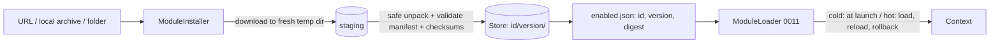

# Proposal 0012 — Module package format and installation

> Format: full (triage score ≥ 3/6 — new public file format, executes downloaded code, hard to reverse).
> The key words MUST, MUST NOT, SHOULD, SHOULD NOT and MAY are to be interpreted as described in RFC 2119.

## 1. Summary

We propose a **module package**: a directory bundle `Name.cordismodule` holding a `module.json` manifest, the module's executable (or library) per platform, and a checksum file, distributed as a single archive or dropped into a dedicated folder. A `ModuleInstaller` downloads, verifies, safely unpacks and installs it side by side by version, so the loader from proposal 0011 can activate it cold at launch or hot at runtime, and roll back by switching version. Unlike a loose folder or an `xcframework`, the package is self-describing and verifiable, at the cost of a new file-format contract.

## 2. Context

### 2.1 Current state

Proposal 0011 (in review) defines loading from a directory containing `module.json` and an executable, but not how that directory gets there: no layout, no archive format, no install, update or rollback story, and the integrity pin is a single hash of the executable. Today nothing downloads or installs code.

### 2.2 Problem

Without a package format each module author invents a layout, an update means overwriting files in place (a running module's binary changes under it), and a download has no defined verification or safe-unpack step. The risk is highest exactly where users get modules from the network.

### 2.4 Glossary

| Term | Definition |
| --- | --- |
| Module package | A `.cordismodule` directory (or its `.zip`/`.tar.gz` archive) with a manifest and payload. |
| Store | The host's dedicated folder holding installed packages as `<id>/<version>/`. |
| Digest | SHA-256 over the package's `checksums.json`; the value pinned host-side. |
| Slice | The platform-specific payload (for example `macos-arm64`, `linux-x86_64`). |

## 3. Goals and non-goals

### 3.1 Goals (verifiable)

- **G1** — A package can be produced by one command and installed from a local archive, a URL, or by copying the directory into the store; all three yield the same installed tree (test: tree and digest equal).
- **G2** — Install never writes outside the store: archives containing `..`, absolute paths, or symlinks leaving the package are rejected (test: crafted archives).
- **G3** — A tampered file (any file listed in `checksums.json`) or a digest different from the pinned one blocks activation.
- **G4** — Installing version N+1 while N runs does not touch N's files; `reload` switches to N+1 and `rollback` switches back (test: file mtimes unchanged, active version changes).
- **G5** — The host selects the payload slice for its platform and fails with a typed error when none matches.

### 3.2 Non-goals

- **NG1** — A registry or marketplace service; installing takes a URL the user supplies.
- **NG2** — Publisher signatures in v1 (see 9, needs a crypto dependency decision).
- **NG3** — Sandboxing (unchanged from 0011 NG2).
- **NG4** — Loading `xcframework` or dynamic libraries in-process in v1 (0011 defers `dlopen`; the format reserves a slot for it).

### 3.3 Requirements

- Process-backend payloads only in v1; the `kind` field reserves `library` so the format does not break later.
- No third-party dependency: archive handling uses system tools or Foundation only (see 4.3), checksums use CryptoKit on Apple and a small pure-Swift SHA-256 on Linux (to verify; otherwise ask before adding `swift-crypto`).
- Compiled for macOS and Linux only, like 0011.

## 4. Proposal

### 4.1 Overview



### 4.2 From the user's point of view

Package layout:

```text
Audit.cordismodule/
  module.json                  manifest (0011) + package fields
  checksums.json               { "path": "sha256", ... } for every other file
  payload/
    macos-arm64/audit-module   executable slice
    linux-x86_64/audit-module
  resources/                   optional data files
```

`module.json` additions over 0011:

```json
{
  "id": "audit", "version": "1.2.0", "apiVersion": 1,
  "kind": "executable",
  "entry": { "macos-arm64": "payload/macos-arm64/audit-module",
             "linux-x86_64": "payload/linux-x86_64/audit-module" },
  "minHostAPI": 1,
  "requires": ["logger"], "provides": ["audit-sink"]
}
```

Host and CLI:

```swift
let installer = ModuleInstaller(store: store)
let pkg = try await installer.install(from: URL(string: "https://example.com/audit-1.2.0.cordismodule.zip")!,
                                      expectedSHA256: "9f2c…")     // hot: download + install
try await modules.load(id: pkg.id)                                 // hot: activate now
try await installer.install(from: localArchiveURL)                 // or a local archive
// or: copy Audit.cordismodule into <store>/audit/1.2.0/ and call modules.rescan()
try await modules.rollback(id: "audit")                            // back to previous version
```

CLI: `mytool modules install <url|path> [--sha256 …]`, `enable`, `load`, `reload`, `unload`, `rollback`. Packaging tool: `cordis-module pack <dir> -o Audit.cordismodule.zip` writes `checksums.json` and prints the archive SHA-256 for the author to publish.

### 4.3 Detailed design

- **Store**: macOS `~/Library/Application Support/<App>/Modules`, Linux `$XDG_DATA_HOME/<app>/modules`. Layout `<id>/<version>/<package contents>`. Directories 0755, files 0644, executables 0755; the store MUST NOT be group or world writable, checked on every load.
- **`enabled.json`** (host-side, outside any package): `{ "audit": { "version": "1.2.0", "digest": "…", "previous": "1.1.0" } }`. `install` records the digest on first install (trust on first use, confirmed by the user when `expectedSHA256` was not supplied); `load` re-verifies the manifest, `checksums.json` digest and the entry executable's hash; full tree verification happens at install.
- **Download**: `URLSession` into a fresh, empty staging directory created by the installer; HTTPS required unless the URL is a local file; size cap (default 256 MB); `expectedSHA256` of the archive checked before unpacking when given.
- **Safe unpack**: `.zip` via `/usr/bin/unzip` and `.tar.gz` via `tar` into staging (system tools, no dependency, to verify availability on target images); afterwards the installer walks the tree and rejects absolute or `..` paths, symlinks, hard links, device files, and anything not in `checksums.json`. The staging tree is validated before anything is moved.
- **Atomic install**: validated tree is moved to `<id>/<version>/` with a single `rename`; an existing version is never overwritten (install of an existing version fails unless identical digest).
- **Update and rollback**: `install` of a new version leaves the running one untouched. `reload` stops the child, then starts the new version from the pointer in `enabled.json`; `rollback` swaps `version`/`previous`. Old versions are pruned only by an explicit `prune`.
- **Slice selection**: the loader builds the key from `os` + `arch` at compile time and looks it up in `entry`; no match yields `ModuleError.noPayload(platform)`.
- **Kinds**: `executable` only in v1. `library` (a `.dylib`/`.framework`, or an `.xcframework` whose `Info.plist` `AvailableLibraries` entries select the slice, keys to verify) is reserved for the deferred in-process backend; an `xcframework` is a build/link artifact with no place for a manifest, so it can be a payload but never the package itself.
- **Cold vs hot** are unchanged from 0011: cold reads `enabled.json` at launch; hot is `install` then `load`/`reload`/`rollback`. Dropping a package into the store is picked up only by an explicit `rescan()` (no file watcher).

### 4.4 Edge cases and errors

| Case | Behaviour |
| --- | --- |
| Archive hash mismatch | Install aborts before unpack: `ModuleError.checksumMismatch`. |
| Path traversal / symlink / extra file | Install aborts, staging deleted. |
| Manifest `id` or `version` differs from the folder name | Rejected. |
| Same id and version already installed, different digest | Rejected: versions are immutable. |
| Disk full or crash mid-install | Only staging is touched; the store is unchanged; staging is cleaned on next start. |
| Executable not runnable on this platform (bad slice, no exec bit) | `.failed` with a typed error at load, store unchanged. |
| Network failure | Typed error; no partial store entry. |
| macOS quarantine flag on a downloaded executable | Spawn may be blocked by Gatekeeper; documented, handled in step 5 (to verify behaviour). |

### 4.5 Goal coverage

| Goal | Where |
| --- | --- |
| G1 | single `install` path for URL, archive, folder; tree-equality test |
| G2 | safe unpack and tree walk in 4.3 |
| G3 | per-file checksums and pinned digest |
| G4 | side-by-side versions and pointer swap |
| G5 | slice selection in 4.3 |

## 5. Alternatives considered

### 5.1 Do nothing

Keep 0011's loose directory. Simplest, but updates overwrite running binaries, there is no safe-unpack or download story, and each author invents a layout.

### 5.2 Standard / off-the-shelf option

SwiftPM binary targets and `xcframework`s for build-time linking (no hot loading, Apple-centred); Apple `NSBundle` plug-in bundles (`.plugin`, `.bundle`) for in-process loading on macOS only. Both solve distribution of linked code, not a verifiable, cross-platform, hot-swappable package of an out-of-process module.

### 5.3 Alternative B — a single flat archive with no directory form

One `.zip` only, unpacked into the store. Less to specify, but authors cannot test a package in place and dropping a folder in is impossible.

### 5.4 Alternative C — `xcframework` as the package

Reuses tooling for per-platform slices, but it has no manifest slot, covers Apple platforms only (no Linux), is built for linking not execution, and cannot express `requires`/`provides`.

### 5.5 Comparison

| | Loose folder (0011) | `.cordismodule` (proposed) | Flat zip | xcframework |
| --- | --- | --- | --- | --- |
| Self-describing | partly | yes | yes | no |
| Verifiable | single hash | per file + digest | per file | no |
| Side-by-side versions | no | yes | yes | n/a |
| Linux | yes | yes | yes | no |
| Drop-in folder | yes | yes | no | n/a |

### 5.6 Abandoned ideas

- Verifying only the executable: a swapped resource file would go unnoticed.
- Auto-installing from a URL found in a manifest: a module must never fetch more code on its own.

## 6. Cross-cutting concerns

- **Security**: downloading and running code is the main risk. Mitigations: HTTPS only, archive hash when published, per-file checksums, safe unpack with a post-walk, immutable versions, host-side pin, store permission checks, no auto-fetch. A pinned hash proves the file is the one the user first accepted, not that it is trustworthy; no signature in v1, so the first install is trust-on-first-use. Not a sandbox (0011 NG2).
- **Privacy / compliance**: the installer contacts only the URL the user gives; no telemetry.
- **Performance / cost**: full verification at install; load re-hashes the manifest, `checksums.json` and the entry executable only.
- **Compatibility**: the format and `module.json` fields are a public contract; `kind`, `apiVersion` and `minHostAPI` give room to evolve. It extends 0011 and renames its single executable hash into the digest scheme; 0011 is not yet accepted, so no migration is needed.
- **Accessibility / UX**: clear install errors and a confirmation prompt showing id, version, digest and publisher URL before first trust.

## 7. Implementation plan

### 7.1 Steps

| Step | Deliverable | Effort | Depends on |
| --- | --- | --- | --- |
| 1 | Package spec, manifest fields, `checksums.json`, validator | 1 d | 0011 step 1 |
| 2 | Safe unpack and tree validation, with crafted-archive tests | 2 d | 1 |
| 3 | `ModuleInstaller` (local archive, folder, URL), atomic install, store layout | 2 d | 2 |
| 4 | `enabled.json` versioned pins, `rollback`, `rescan` | 1 d | 3 |
| 5 | `cordis-module pack` tool, quarantine behaviour check on macOS | 1 d | 3 |

### 7.2 Migration

None. 0011 is unreleased; its loose-folder layout becomes the unpacked form of a package.

### 7.3 Rollout and rollback

Ships inside the experimental `CordisModules` product. Rollback: remove the installer; the loader still reads a store folder as in 0011.

### 7.4 Test strategy

Swift Testing. Crafted archives for traversal, symlink, hard link, extra file, oversized, wrong hash. Install tree equality across the three sources. Side-by-side version and rollback with mtime checks. Slice selection on a fake platform key. A real archive of the reference test module from 0011.

### 7.5 Observability

`ModuleOutcome` and install events (`ModuleInstalled`, `ModuleInstallFailed`) with id, version, digest; no payload contents logged.

## 8. Prior art

- Apple bundles and `.plugin` / `.bundle` packages, and `xcframework` for multi-platform binary distribution.
- VS Code `.vsix` extension packages: a zip with a manifest, installed side by side by version.
- HashiCorp Terraform provider registry: versioned archives with published checksums and optional signatures (to verify details).
- Python wheels and npm tarballs: archive plus metadata, with path-traversal hardening requirements.

## 9. Open questions

1. Name and extension: `.cordismodule` (consistent with "module" in 0011) or `.cordisplugin`? "Plugin" is the kernel term for an applied behaviour. (decider)
2. Are publisher signatures required for v1? That would need Ed25519, i.e. CryptoKit on Apple plus `swift-crypto` on Linux, a third-party dependency that needs approval. (decider)
3. Is system `unzip`/`tar` acceptable, or must unpacking be pure Swift? (decider)
4. Should the host UI/CLI always show a confirmation for first-time trust, or allow `--yes` for automation? (author)

## 10. Review log

| Date | Reviewer | Verdict | Changes made |
| --- | --- | --- | --- |
| 2026-10-24 | design-proposal-reviewer | No, because premature and over-scoped: depends on unaccepted 0011 (spike unmet), extract-then-check unpack cannot meet G2, G3 contradicts load-time checks, hashing dependency unresolved, TOFU re-pin on every update. Not fixed; escalated to decider. | none |

## 11. Decision

<!-- Decision, date, decider, conditions, ADRs produced. -->

## Amendments

<!-- Append-only after acceptance. -->
